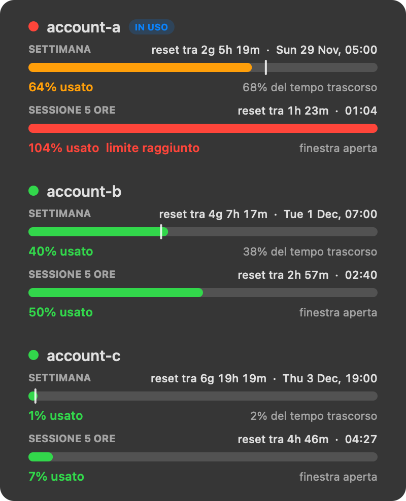
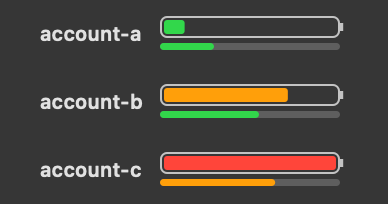
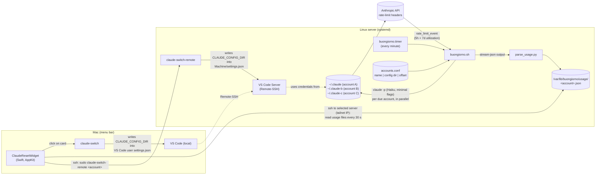
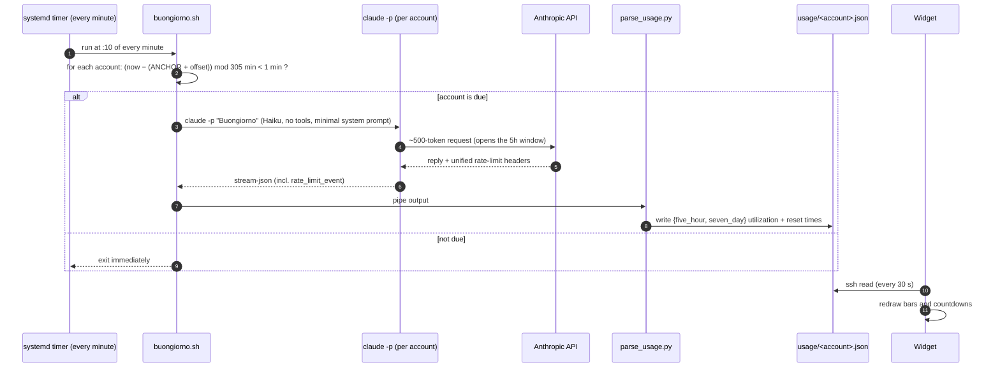

# Claude Reset Widget

A macOS menu-bar widget plus a small server-side timer that help you **manage several Claude (claude.ai) subscription accounts**:

- see **how saturated** each account's **5-hour session window** and **weekly limit** really are (real numbers, not estimates);
- see **when** each window and weekly limit **resets**, as countdowns;
- **keep the 5-hour windows staggered** across accounts by pinging each one on a schedule that costs almost nothing ("Buongiorno");
- **switch the account used by the Claude Code VS Code extension** with one click, locally or on a remote (Remote-SSH) machine, without logging in again.

> The widget UI is in Italian (labels such as *SETTIMANA* = week, *SESSIONE 5 ORE* = 5-hour session, *IN USO* = in use, *usato* = used, *limite raggiunto* = limit reached). Strings live in `main.swift` if you want to translate them.

<p align="center"></p>

All account names, dates and numbers in the screenshots are fictional. The images are rendered from the real widget code by `tools/render_docs.sh`.

---

## Table of contents

1. [What you get](#what-you-get)
2. [Reading the UI](#reading-the-ui)
3. [Architecture](#architecture)
4. [Where the numbers come from](#where-the-numbers-come-from)
5. [Buongiorno: starting 5-hour windows for ~0 tokens](#buongiorno-starting-5-hour-windows-for-0-tokens)
6. [Switching accounts in VS Code](#switching-accounts-in-vs-code)
7. [Installation](#installation)
8. [Configuration reference](#configuration-reference)
9. [Repository layout](#repository-layout)
10. [Security and privacy](#security-and-privacy)
11. [Limitations and caveats](#limitations-and-caveats)
12. [Troubleshooting](#troubleshooting)
13. [Regenerating the screenshots](#regenerating-the-screenshots)

---

## What you get

| Component | Runs on | Purpose |
|---|---|---|
| `main.swift` → `ClaudeResetWidget` | each Mac (menu bar) | Shows usage bars and countdowns, switches accounts on click |
| `claude-switch` | the Mac running VS Code locally | Points the VS Code Claude extension at one account's credential folder |
| `claude-switch-remote` | the server used through Remote-SSH | Same, for the VS Code server on that machine |
| `buongiorno/` | a Linux server (systemd) | Pings every account every 5h05m with a tiny request, and records real usage |

You can use only the part you need: the widget alone works as a plain countdown (no server needed); the server timer alone works as a headless window starter.

## Reading the UI

### Menu bar (always visible)

<p align="center"></p>

The menu bar shows **only the account currently in use** (the one selected for VS Code):

- **Battery bar (top)** – saturation of the **5-hour session window**.
- **Thin bar (bottom)** – saturation of the **weekly limit**.
- Colors: **green** < 60 %, **orange** 60–85 %, **red** > 85 % (a full red bar means the window is exhausted).

No numbers are drawn in the menu bar on purpose; open the menu for details. If no usage data is available yet, a text countdown to the nearest weekly reset is shown instead.

### Menu (click the widget)

One card per account:

- **Header** – status dot (color = the worse of the two saturations) and the account name. A blue **IN USO** pill marks the account currently selected in VS Code.
- **SETTIMANA (week)** – bar = share of the weekly limit used. The **white tick** shows how much of the week has elapsed: if the colored bar is to the *right* of the tick you are consuming faster than time passes. Right side: countdown and date of the next weekly reset.
- **SESSIONE 5 ORE (5-hour session)** – bar = share of the 5-hour window used, with the reset countdown and clock time. Over 100 % shows *limite raggiunto* (limit reached).
- **Click a card** to make that account the active one for VS Code (see [Switching accounts](#switching-accounts-in-vs-code)). The menu closes and the **IN USO** pill moves.
- A submenu (*Account VS Code* / *Account Claude sul server*) offers the same switch as a list.
- **Server: …** submenu – choose which server (tailnet IP) the widget reads usage from and switches accounts on, with live online/offline status.

## Architecture



### Responsibilities

- **Widget** – pure presentation plus two actions (switch account, open config). It computes weekly-reset countdowns locally from the anchors in `accounts.json`, and reads real utilization from the server over SSH. It never touches Claude credentials.
- **Server timer** – the only component that talks to Claude. Each account lives in its own *config directory* selected with the `CLAUDE_CONFIG_DIR` environment variable, so several logins coexist without interfering.
- **Switch scripts** – edit one VS Code setting, `claudeCode.environmentVariables`, which the Claude Code extension passes to the `claude` process it launches. Switching = changing which config directory that process uses.

### One cycle of Buongiorno



### Why the windows are staggered

A Claude subscription has a rolling **5-hour session window** that starts with the first message after the previous window expired. Sending a ping every **5 h 05 min** per account means a fresh window opens as soon as the previous one ends. Offsetting the accounts by `305 / N` minutes (for 3 accounts: 0, 102 and 203 minutes) spreads the resets so that **one account's window resets roughly every 100 minutes**, which means you almost always have an account with quota available or about to be.

## Where the numbers come from

- **Weekly reset countdown** – computed locally. `accounts.json` stores *one* known weekly-reset instant (`anchor`) per account; the next reset is `anchor + 7 × n days`, rolling forward forever.
- **5-hour window and weekly utilization** – reported by Claude Code itself. When run with `--output-format stream-json --verbose`, `claude -p` emits a `rate_limit_event` containing `unifiedWindows.five_hour` and `unifiedWindows.seven_day`, each with a `utilization` (fraction of the window used, usually 0–1, may exceed 1) and a `resetsAt` (epoch seconds). These are taken from the server's `anthropic-ratelimit-unified-*` response headers, so they reflect the *real* account state, including usage from other devices and people sharing the account.
- **Freshness** – the data is captured each time Buongiorno pings an account (every 5 h 05 min). Usage between pings is not reflected until the next one. See [limitations](#limitations-and-caveats).
- If a stored reset time is already in the past, the widget treats that reading as stale and falls back to its schedule-based estimate for that window.

Example usage file (`/var/lib/buongiorno/usage/account-a.json`):

```json
{"updated": 1795733037,
 "five_hour": {"utilization": 0.08, "resetsAt": 1795745400},
 "seven_day": {"utilization": 0.01, "resetsAt": 1796320800}}
```

## Buongiorno: starting 5-hour windows for ~0 tokens

`buongiorno/buongiorno.sh` is run every minute by a systemd timer and sends **"Buongiorno"** to each account that is due. To keep the cost negligible it runs Claude Code in a minimal configuration:

```
claude -p "Buongiorno" --model haiku --system-prompt "Reply with one character." \
       --tools "" --strict-mcp-config --disable-slash-commands --setting-sources "" \
       --output-format stream-json --verbose
```

Measured on one request: default configuration ≈ **21,000 tokens (≈ $0.03)**; minimal configuration ≈ **530 tokens (≈ $0.0001)**. The reduction comes from using a small model and dropping Claude Code's large system prompt, tool definitions, MCP servers, plugins and user settings.

Behavior details:

- Accounts run **in parallel**, so retries on one never delay another.
- On failure it retries up to 3 times with a 2-minute pause. A "session limit reached" error is logged and simply retried at the next cycle.
- Accounts whose config directory is not logged in are **skipped** (logged as `not authenticated`).
- Timing is derived from a fixed `ANCHOR`, so schedules never drift. If the host is off at a due minute, that ping is skipped.
- Logs: `/var/log/buongiorno/buongiorno.log`, each line prefixed with `[account]`.

> Assumption: a message to *any* model opens the shared 5-hour window. If you observe that a Haiku ping does not start the window on your plan, change `MIN_FLAGS` in `buongiorno.sh` to a larger model.

## Switching accounts in VS Code

The Claude Code extension launches a `claude` process with the environment variables from the VS Code setting `claudeCode.environmentVariables`. Every account has its own config directory (credentials + settings). Switching writes one entry:

```jsonc
// VS Code settings.json
"claudeCode.environmentVariables": [
  { "name": "CLAUDE_CONFIG_DIR", "value": "/path/to/account-b-config-dir" }
]
```

The default account (config dir `~/.claude`) has **no** entry; switching back to it removes the entry. Both scripts take a backup (`settings.json.bak`) before editing local settings and refuse to touch a settings file that is not valid JSON.

### Local VS Code

```bash
./claude-switch list              # accounts, * = active
./claude-switch login account-b   # one-time login into that account's config dir
./claude-switch account-b         # make it the active account
```

### VS Code on another Mac connected to a server (Remote-SSH)

When VS Code runs on machine **M** and connects to server **S**, the extension runs *on S*; the setting is `machine`-scoped, so it must be written on S:

```bash
# on the server
claude-switch-remote list
claude-switch-remote account-b
```

From the menu-bar widget on M, add the server to `servers.json` with `"remoteSwitch": true`; clicking a card then runs `ssh <user>@<tailnet-ip> [sudo] /usr/local/bin/claude-switch-remote <name>` on the **currently selected server**. No new access is created: it reuses an SSH key that already works.

After switching, **open a new Claude conversation** (or run *Developer: Reload Window*). Conversations already open keep the account they started with.

### Logging an account in (once)

```bash
CLAUDE_CONFIG_DIR=/path/to/account-b-config-dir claude auth login
CLAUDE_CONFIG_DIR=/path/to/account-b-config-dir claude auth status   # verify the e-mail!
```

Open the login link in a **private/incognito window**; otherwise the browser may silently reuse another claude.ai session and you end up with the same account twice.

## Installation

### 1. Widget (macOS, Xcode command-line tools required)

The widget expects to live in `~/ClaudeResetWidget` (paths are hard-coded in `main.swift`).

```bash
git clone <this repo> ~/ClaudeResetWidget && cd ~/ClaudeResetWidget
cp accounts.example.json accounts.json        # edit names, anchors, offsets, configDirs
swiftc -O main.swift -o ClaudeResetWidget
./ClaudeResetWidget &                         # appears in the menu bar
```

Start at login with a LaunchAgent (`~/Library/LaunchAgents/com.user.claudeResetWidget.plist`):

```xml
<?xml version="1.0" encoding="UTF-8"?>
<!DOCTYPE plist PUBLIC "-//Apple//DTD PLIST 1.0//EN" "http://www.apple.com/DTDs/PropertyList-1.0.dtd">
<plist version="1.0"><dict>
  <key>Label</key><string>com.user.claudeResetWidget</string>
  <key>ProgramArguments</key><array><string>/Users/YOU/ClaudeResetWidget/ClaudeResetWidget</string></array>
  <key>RunAtLoad</key><true/><key>KeepAlive</key><true/>
</dict></plist>
```
```bash
launchctl load ~/Library/LaunchAgents/com.user.claudeResetWidget.plist
```

The widget re-reads `accounts.json` every 30 s, so edits apply without a restart.

> If `swiftc` fails with "this SDK is not supported by the compiler", your command-line tools and SDK are out of sync; update the tools, or compile on another Mac and copy the binary (an x86_64 binary runs on Apple Silicon through Rosetta 2).

### 2. Server timer (Linux + systemd, as root)

```bash
cd buongiorno
cp accounts.example.conf accounts.conf     # name | config dir | offset in minutes
./install.sh                                # installs /opt/buongiorno, the systemd units, enables the timer
```

Log every account in (see above), then test one:

```bash
/opt/buongiorno/buongiorno.sh --force account-b
tail -f /var/log/buongiorno/buongiorno.log
cat /var/lib/buongiorno/usage/account-b.json
```

Requirements: Claude Code CLI at `/root/.local/bin/claude`, `python3`, systemd.

### 3. Choose the server(s) the widget talks to (tailnet IPs)

List your servers in `servers.json`, using their **Tailscale (tailnet) IPs**, then pick one from the menu (**Server: …** submenu). The selected server is where the widget reads real usage from and, optionally, where it switches the Claude account.

```bash
cp servers.example.json servers.json          # edit: name, tailnet IP, user, key
```

Key-based SSH must work non-interactively (`ssh -o BatchMode=yes <user>@<tailnet-ip> true`). Usage files are world-readable, so any user that can log in can read them.

The submenu shows each server's live status from the Tailscale CLI, matched by IP: `●` online, `○` offline, `·` unknown. Your choice is remembered in `server_selected.txt`; switching server instantly reloads usage (and the account list, if remote switching is enabled).

### 4. (Optional) Use all your accounts on other servers

Buongiorno only needs to run on **one** server. Other servers (used through VS Code Remote-SSH) only need the logins and the switch script. **Log in separately on each server; do not copy credentials between machines.** A copied login shares its refresh token with the original, so when either side refreshes, the other can end up with "OAuth session expired and could not be refreshed" (this happened in practice, even breaking the original).

```bash
# interactive: one login per account on that server (open each link in a private browser window)
tools/login-accounts.sh dev@<other-tailnet-ip> account-a account-b      # DEFAULT=account-c ... if ~/.claude there is already account-c
# install the switch script for that user
scp claude-switch-remote dev@<other-tailnet-ip>:/tmp/ && ssh dev@<other-tailnet-ip> 'mkdir -p ~/.local/bin && install -m 755 /tmp/claude-switch-remote ~/.local/bin/'
```

`login-accounts.sh` creates `~/.claude-<name>/` on the target, runs the login there, writes `~/.claude-accounts.conf` and verifies every account with a real request (note: `claude auth status` alone says `loggedIn: true` even for expired logins, so it is not a valid check). An existing default login on the target is never touched.

If your SSH key has a passphrase, load it once so the widget can use it non-interactively: `ssh-add --apple-use-keychain /path/to/key` (on every Mac running the widget).

### 5. (Optional) Switch accounts on the server from the widget

```bash
scp claude-switch-remote root@<tailnet-ip>:/usr/local/bin/ && ssh root@<tailnet-ip> chmod +x /usr/local/bin/claude-switch-remote
```
Then set `"remoteSwitch": true` (and `"sudo": true` if the SSH user is not root) on that server in `servers.json`.

## Configuration reference

### `accounts.json` (widget, per Mac; git-ignored)

```json
[
  {"name": "account-a", "anchor": "2026-12-03T19:00:00+01:00", "offset": 0},
  {"name": "account-b", "anchor": "2026-12-01T07:00:00+01:00", "offset": 102, "configDir": "~/.claude-account-b"}
]
```

| Field | Meaning |
|---|---|
| `name` | Label; **must equal the name used in `accounts.conf`** so usage files match |
| `anchor` | Any one weekly-reset instant (ISO 8601 with offset); the widget repeats it every 7 days |
| `offset` | Minutes of stagger in the 305-minute Buongiorno cycle (must match `accounts.conf`); omit to hide 5-hour info |
| `configDir` | Claude config dir of this account on **this** Mac, for local switching; omit = default `~/.claude` |

### `buongiorno/accounts.conf` (server; git-ignored)

```
# name | config_dir | offset_min
account-a|default|0
account-b|/root/.claude-account-b|102
account-c|/root/.claude-account-c|203
```

`default` means the user's standard `~/.claude`. Offsets: use `305 / N` minutes between accounts.

### `servers.json` (widget, per Mac; git-ignored)

```json
[
  {"name": "main", "host": "100.64.0.10", "user": "root", "buongiorno": true},
  {"name": "dev-box", "host": "100.64.0.11", "user": "dev", "key": "~/.ssh/id_ed25519_dev",
   "switchPath": "~/.local/bin/claude-switch-remote", "remoteSwitch": true}
]
```

| Field | Meaning |
|---|---|
| `name` | Label shown in the **Server** submenu and stored in `server_selected.txt` |
| `host` | The server's **tailnet IP** (also used to look up online status in `tailscale status`) |
| `user` | SSH user (omit to use your default) |
| `key` | Private key to use (`IdentitiesOnly`); omit to use your normal SSH configuration |
| `sudo` | Run `claude-switch-remote` through passwordless `sudo` (needed when `user` is not root) |
| `buongiorno` | `true` on the server that runs Buongiorno: **usage is always read from it**, whichever server is selected, so the bars stay visible on servers without Buongiorno |
| `switchPath` | Where `claude-switch-remote` lives on that server (default `/usr/local/bin/claude-switch-remote`; use `~/.local/bin/claude-switch-remote` for a non-root user) |
| `remoteSwitch` | `true`: clicking a card switches the account **on this server** (VS Code over Remote-SSH). `false`/omitted: clicking switches the local VS Code |

Without a `servers.json` the widget still works as a plain countdown with local account switching.

### Other knobs in `buongiorno.sh`

`ANCHOR` (cycle origin), `INTERVAL_MIN` (305), `MIN_FLAGS` (request configuration), `BUONGIORNO_PROMPT` (message text), `USAGE_DIR`.

## Repository layout

```
main.swift                 Menu-bar widget (AppKit, single file)
claude-switch              Switch the account used by local VS Code
claude-switch-remote       Same, for a VS Code server over Remote-SSH (any user)
accounts.example.json      Widget accounts template
servers.example.json       Widget servers template (tailnet IPs)
buongiorno/
  buongiorno.sh            Timer logic + minimal Claude request
  parse_usage.py           Extracts utilization from stream-json output
  accounts.example.conf    Server accounts template
  install.sh / uninstall.sh / next_runs.sh
  systemd/                 buongiorno.service, buongiorno.timer
tools/
  login-accounts.sh        Interactive per-server Claude logins (no credential copying)
  render_docs.sh           Renders docs/*.png from the real widget code
  harness.swift            Fictional data used for the screenshots
docs/                      Screenshots used by this README
```

## Security and privacy

- **Credentials never enter this repo or the widget.** Logins live in each account's config directory (and the macOS Keychain); the widget and scripts only reference the directory path.
- Personal files are git-ignored: `accounts.json`, `accounts.conf`, `servers.json`, `server_selected.txt`, binaries and `*.bak`.
- The widget talks only to hosts you configure, over SSH with `BatchMode` (no password prompts). Usage files contain only utilization fractions and reset timestamps.
- The server timer sends real (tiny) requests to Anthropic with your accounts; they count against your usage and are subject to Anthropic's terms for your plan.
- `claude-switch-remote` needs write access to the VS Code server's settings, hence it is meant to run as the same user that runs the VS Code server (often root in containers).

## Limitations and caveats

- **Undocumented fields.** `rate_limit_event.unifiedWindows` comes from Claude Code's stream output, not a documented public API; it may change between versions. The widget falls back to schedule-based estimates if usage data is missing or stale.
- **Data is as fresh as the last ping** (every 5 h 05 min per account). Usage in between is not visible until the next ping. A lighter, more frequent probe is possible but consumes a little quota each time.
- **Weekly anchors are fixed UTC offsets** (e.g. `+01:00`). Around daylight-saving changes the displayed reset can be off by one hour until you update the anchor.
- Account switching affects **all VS Code windows** at once and only **new** conversations.
- Several accounts logged into the same human may share quotas depending on your organization plan; the widget shows what the API reports per login.
- Compiled binary is single-architecture; see the Rosetta note above.

## Troubleshooting

| Symptom | Check |
|---|---|
| Menu bar shows a text countdown, not bars | No `servers.json`, selected server unreachable, or no usage files yet. Try `ssh -o BatchMode=yes <user>@<tailnet-ip> 'ls /var/lib/buongiorno/usage'` |
| Two accounts show identical numbers | They were logged in to the same claude.ai user. Run `CLAUDE_CONFIG_DIR=… claude auth status` for each and re-login in a private window |
| `not authenticated, skipping` in the log | That config dir has no login; run `claude auth login` with its `CLAUDE_CONFIG_DIR` |
| Clicking a card does nothing visible | Open a new Claude conversation / reload the VS Code window; check `./claude-switch list` or `claude-switch-remote list` |
| "server non raggiungibile…" in the submenu | the selected server in `servers.json` can't be reached non-interactively, or `sudo` needs a password |
| `You've hit your session limit` in the log | Expected when an account is exhausted; it retries next cycle |
| Widget menu looks stale | It refreshes every 30 s; restart with `launchctl kickstart -k gui/$(id -u)/com.user.claudeResetWidget` |

## Regenerating the screenshots

```bash
./tools/render_docs.sh     # compiles the real widget views with fictional data → docs/menu.png, docs/menubar.png
```

The renderer reuses `main.swift` (everything before the app bootstrap) and `tools/harness.swift`, so the images always match the actual UI.
